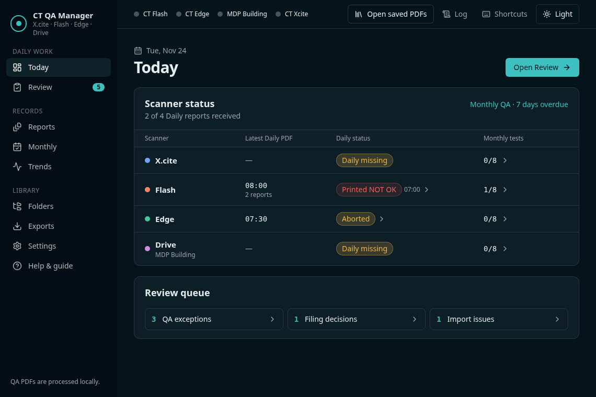

# CT QA Manager

**An offline Windows workspace for Siemens CT quality assurance.** Open scanner QA PDFs, track daily receipt and monthly checks, and file reports into a local QA Library.

[**Download for Windows x64**](https://github.com/rtariq2015/CT-QA-Manager/releases/latest/download/CT-QA-Manager-Windows-x64.zip) · [Release notes](https://github.com/rtariq2015/CT-QA-Manager/releases/latest) · [CT QA Manager Pro](https://github.com/rtariq2015/QA-Manger)



## Start on Windows

1. Download the Windows ZIP and extract the full folder to a writable location.
2. Double-click **CT QA Manager.exe**. The app opens in its own window.
3. Choose **Folders → Open folder** for local PDFs, or save scanner locations under **Settings**. Network shares require access to the network that hosts them.

Use **Saved PDFs** to open the **QA Library** next to the program. Keep the full program folder together when copying to another computer or USB drive. Before upgrading, keep a copy of your QA Library and export a settings and filing backup.

## Update an existing Windows copy

1. Close CT QA Manager and extract the [smaller Windows Update ZIP](https://github.com/rtariq2015/CT-QA-Manager/releases/latest/download/CT-QA-Manager-Update-x64.zip).
2. Double-click **Apply-Update.cmd** and paste the path of the folder containing **CT QA Manager.exe**.
3. Open the program again. The update replaces the app files and keeps the previous app files as a backup.

The updater checks the installed Electron version. Use the full Windows ZIP if the runtime changes.

## Copy scanner settings

Click **Save** in Windows Settings to write **Settings.json** beside the executable. Copy it beside the executable in another copy before launching, or use **Settings → Scanner folders → Import Settings.json**. The file contains folder paths, usernames and scheduling preferences. Passwords stay encrypted on the original PC and may need to be entered again on another Windows account or computer.

## Workspaces

| Workspace | What you can do |
| --- | --- |
| **Today** | Check Daily QA receipt, pending reviews, printed exceptions, and monthly deadlines. |
| **Reports** | Search imported reports, open the source PDF, and check receipt on the calendar. |
| **Review** | Open failed imports and their original PDFs, review flagged readings, file reports, and undo a filing. |
| **Monthly and Trends** | View the monthly checklist and chart supported readings against the printed limits. |
| **Folders and Exports** | Browse the organized library and export PDFs with a CSV and HTML summary. |
| **Settings** | Configure scanner folders and the QA schedule, or back up settings and filing decisions. |

## How reports are handled

The parser supports older Siemens syngo VB PDFs and syngo VA40A reports, including SOMATOM Drive, Flash, Edge, and X.cite. It retains printed results and supported readings with their printed tolerances. Incomplete extractions and exceptions stay visible for review. Filing is a document classification step and leaves the scanner’s printed result intact.

The desktop app works offline with local PDFs. Windows protects saved network credentials, and backups include filing decisions and settings. The report library starts empty until you import PDFs or connect a scanner folder.

## Reopen saved reports

The Windows app stores a local report catalog with the PDFs in **QA Library**. At startup, Reports, Review and Trends can reopen saved records without reading the scanner PDFs again. Configured folders are checked in the background and unchanged, indexed PDFs are skipped.

The first scan after upgrading from an earlier version builds the catalog. Older PDFs whose source folders are unavailable can be imported from a saved copy.

## Review by scanner

In **Review**, select a scanner to see its pending reports. When the selected PDF has matching reports, choose **Review matching reports**, inspect the list, and confirm **Daily**, **Monthly**, or **Other** once. Matches require the same scanner, software, printed tests, and measurement layout. Printed exceptions and incomplete reports stay available for individual review. **Undo last group** reverses the last group filing in the current session.

## Organize Daily and Monthly reports

Classification uses the printed procedure. An explicit Daily or Monthly title can identify the category. A Siemens IEC Constancy summary with only noise and homogeneity/water can classify as Daily. Advanced IEC Constancy tests such as MTF or light-marker checks can classify as Monthly. Acceptance and ambiguous documents stay available for a filing decision.

A classified PDF can still need review because it printed NOT OK, contains an out-of-limit measurement, or has incomplete extraction. For older entries, **Review → Organize Daily / Monthly** checks saved originals and files only reports with enough printed evidence. Use **Acknowledge** after you have reviewed a filed exception.

## Review import issues

If a PDF cannot be parsed, open **Review → Import issues** to see the reason and original PDF. Windows keeps a copy in **QA Library → Review Inbox**, so you can reopen it after restarting. **Mark reviewed** clears the item from the inbox while retaining the copy. The web workspace keeps originals for the current session.

## Share a diagnostic

Open **Log → Download diagnostic file** to share scan totals, read timings, cache hits, review reasons, and connection error codes. The diagnostic keeps the last 60 scans separately from the detailed activity log and omits file names, folder paths, and PDF contents. Use **Download log** for the detailed local history.

## Build from source

```sh
npm install
npm test
npm run dev
npm run build
npm run package:windows
```

The package command creates `electron-release/CT QA Manager-win32-x64`. The desktop renderer uses a stable local address for settings and filing decisions across restarts. The web build processes PDFs locally after you select a folder or files using the browser.
