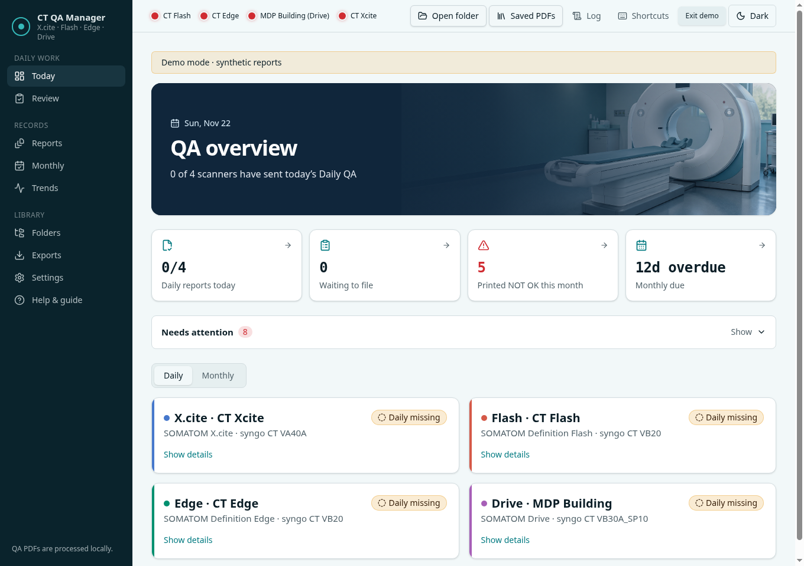

# CT QA Manager

**An offline Windows workspace for Siemens CT quality assurance.** Open scanner QA PDFs, track daily receipt and monthly checks, and file reports into a local QA Library.

[**Download for Windows x64**](https://github.com/rtariq2015/CT-QA-Manager/releases/latest/download/CT-QA-Manager-Windows-x64.zip) · [Release notes](https://github.com/rtariq2015/CT-QA-Manager/releases/latest) · [CT QA Manager Pro](https://github.com/rtariq2015/QA-Manger)



## Start on Windows

1. Download the Windows ZIP and extract the full folder to a writable location.
2. Double-click **CT QA Manager.exe**. The app opens in its own window.
3. Choose **Open folder** for local PDFs, or save scanner locations under **Settings**. Network shares require access to the network that hosts them.

Use **Saved PDFs** to open the **QA Library** next to the program. Keep the full program folder together when copying to another computer or USB drive. Before upgrading, keep a copy of your QA Library and export a settings and filing backup.

## Workspaces

| Workspace | What you can do |
| --- | --- |
| **Today** | Check Daily QA receipt, pending reviews, printed exceptions, and monthly deadlines. |
| **Reports** | Search imported reports, open the source PDF, and check receipt on the calendar. |
| **Review** | Check unreadable or flagged results, file as Daily, Monthly, or Other, and undo a filing. |
| **Monthly and Trends** | View the monthly checklist and chart supported readings against the printed limits. |
| **Folders and Exports** | Browse the organized library and export PDFs with a CSV and HTML summary. |
| **Settings** | Configure scanner folders and the QA schedule, or back up settings and filing decisions. |

## How reports are handled

The parser supports older Siemens syngo VB PDFs and syngo VA40A reports, including SOMATOM Drive, Flash, Edge, and X.cite. It retains printed results and supported readings with their printed tolerances. Incomplete extractions and exceptions stay visible for review. Filing is a document classification step and leaves the scanner’s printed result intact.

The desktop app works offline with local PDFs. Windows protects saved network credentials, and backups include filing decisions and settings. Live mode starts with your imported reports. Choose **Demo data** to explore synthetic examples.

## Build from source

```sh
npm install
npm test
npm run dev
npm run build
npm run package:windows
```

The package command creates `electron-release/CT QA Manager-win32-x64`. The desktop renderer uses a stable local address for settings and filing decisions across restarts. The web build processes PDFs locally after you select a folder or files using the browser.
